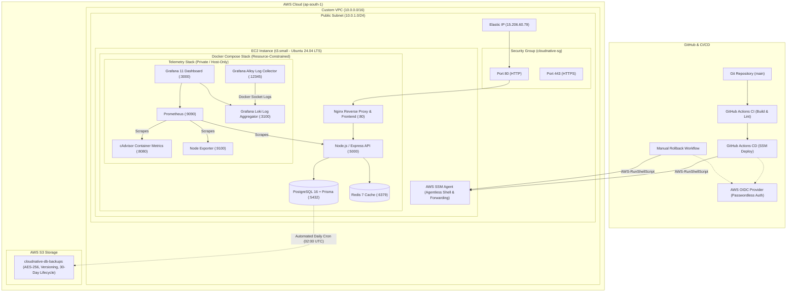

# CloudNative — Enterprise Cloud & DevOps Observability Platform

[](https://github.com/shivanshks06/Cloudnative/actions/workflows/deploy.yml)
[](https://www.terraform.io/)
[](https://aws.amazon.com/)
[](https://www.docker.com/)
[](https://prometheus.io/)
[](https://grafana.com/oss/loki/)
[](https://k6.io/)

CloudNative is an end-to-end, production-grade cloud workload demonstrating modern **DevOps, Site Reliability Engineering (SRE), Infrastructure as Code (IaC), GitOps CI/CD, Observability, Disaster Recovery, and Zero-Trust Security Hardening**.

---

## Architecture Overview



---

## DevOps Technology Stack

| Domain | Technology / Tool | Implementation Details |
|---|---|---|
| **Infrastructure as Code** | **Terraform (v1.5+)** | Declarative configuration for VPC, subnets, internet gateways, security groups, EC2, Elastic IP, IAM roles, and instance profiles. |
| **Cloud Provider** | **AWS (ap-south-1)** | EC2 (`t3.small`), VPC, Elastic IP, S3, IAM, Parameter Store, Systems Manager (SSM). |
| **CI/CD Pipeline** | **GitHub Actions** | Automated linting, multi-architecture container builds, image pushing to Docker Hub, and zero-touch remote deployment. |
| **Authentication & IAM** | **AWS OIDC (OpenID Connect)** | Passwordless AWS authentication for GitHub Actions — zero static AWS access keys stored in repository secrets. |
| **Remote Orchestration** | **AWS Systems Manager (SSM)** | Agentless deployment and management (`AWS-RunShellScript`) — completely eliminated public SSH access (port 22). |
| **Containerization** | **Docker & Buildx** | Multi-stage Docker builds, unprivileged non-root runtime users, healthcheck probes, and minimal Alpine/Debian-slim base images. |
| **Container Orchestration**| **Docker Compose v2** | CPU quotas, memory limits, custom bridge network segregation, volume retention, and dependency ordering (`depends_on`). |
| **Reverse Proxy** | **Nginx** | Reverse proxy routing web traffic to React frontend and Express backend with optimized caching and gzip compression. |
| **Database & ORM** | **PostgreSQL 16 + Prisma** | Relational data persistence with automated Prisma schema migrations running on startup. |
| **Caching Layer** | **Redis 7** | In-memory key-value caching layer with password protection and automated eviction policies. |
| **Metrics Collection** | **Prometheus** | Metric scraping every 15s across Node.js `/api/metrics`, Node Exporter, cAdvisor, and system endpoints with 7-day TSDB retention. |
| **Metrics Visualization** | **Grafana 11** | Auto-provisioned dashboards: **CloudNative Overview** (system & app metrics) and **CloudNative Logging** (centralized logs). |
| **Container Monitoring** | **cAdvisor (Google)** | Real-time container resource telemetry (CPU per container, memory usage vs. limit, network I/O, disk throttling). |
| **Host Monitoring** | **Node Exporter** | Kernel-level host hardware metrics (load averages, filesystem utilization, memory pressure, network sockets). |
| **Centralized Logging** | **Grafana Loki & Alloy** | Log shipping pipeline: Alloy consumes the Docker engine socket and streams structured JSON logs directly into Loki. |
| **Database Backups** | **Bash + AWS S3 + Cron** | Automated daily compressed database dumps (`pg_dump | gzip`), SSE-AES256 encrypted S3 storage, versioning, and 30-day lifecycle expiry. |
| **Performance Testing** | **Grafana k6** | Automated load testing suite simulating staged concurrent user traffic against production SLAs. |
| **Disaster Recovery** | **Immutable Rollback Engine** | One-click manual rollback workflow restoring previous immutable Git commit SHA image tags. |

---

## 1. Cloud Infrastructure & Security Hardening

### Zero-Trust Network Perimeter
* **Public Ports Restricted:** Only port `80` (HTTP) and port `443` (HTTPS) accept public traffic in `cloudnative-sg`.
* **Zero Open Telemetry Ports:** Prometheus (`9090`), Grafana (`3000`), Loki (`3100`), Alloy (`12345`), and cAdvisor (`8080`) are **not** exposed to the internet. They are bound locally and accessed securely via encrypted AWS SSM Port Forwarding tunnels.
* **Eliminated SSH Ingress:** Port `22` is removed entirely. All administrative access, maintenance, and deployments execute through AWS SSM Session Manager.
* **IMDSv2 Enforcement:** EC2 instance metadata requires token-based authentication (`http_tokens = "required"`, `http_endpoint = "enabled"`), mitigating Server-Side Request Forgery (SSRF) vulnerabilities.

```bash
# Securely forward Grafana (Port 3000) to localhost without opening public firewall ports:
aws ssm start-session \
  --target "$INSTANCE_ID" \
  --document-name AWS-StartPortForwardingSession \
  --parameters '{"portNumber":["3000"],"localPortNumber":["3000"]}' \
  --profile cloudnative \
  --region ap-south-1

# Open in browser: http://localhost:3000
```

---

## 2. Docker Container Resource Governance

All 9 production containers run with strict kernel memory caps and CPU quotas to prevent resource starvation on `t3.small` (2 vCPU, 2 GiB RAM):

| Container Name | Service | Memory Limit | CPU Quota | Healthcheck |
|---|---|---|---|---|
| `cloudnative-frontend` | Nginx & React SPA | `128 MB` | `0.25` | `curl -f http://localhost:80/` |
| `cloudnative-backend` | Node.js Express API | `256 MB` | `0.50` | `curl -f http://localhost:5000/api/health` |
| `cloudnative-postgres` | PostgreSQL 16 DB | `384 MB` | `0.50` | `pg_isready -U postgres` |
| `cloudnative-redis` | Redis 7 Cache | `128 MB` | `0.25` | `redis-cli ping` |
| `cloudnative-prometheus`| Prometheus TSDB | `256 MB` | `0.35` | `wget -q --spider http://localhost:9090/-/healthy` |
| `cloudnative-grafana` | Grafana 11 Dashboard | `256 MB` | `0.35` | `curl -f http://localhost:3000/api/health` |
| `cloudnative-cadvisor` | cAdvisor Telemetry | `128 MB` | `0.25` | Container runtime metrics |
| `cloudnative-node-exporter`| Node Exporter | `Host Net` | Host PID | Kernel metrics |
| `cloudnative-loki` | Loki Log Aggregator | `256 MB` | `0.35` | `curl -f http://localhost:3100/ready` |
| `cloudnative-alloy` | Alloy Log Shipper | `128 MB` | `0.25` | Native service pipeline |

---

## 3. Automated S3 Backups & Disaster Recovery

### Backup Architecture
1. **Automated Cron Execution:** EC2 triggers `/opt/cloudnative/scripts/backup-db.sh` daily at `02:00 UTC`.
2. **Atomic Gzip Pipeline:** Streams database output into a gzip archive without storing uncompressed SQL on disk:
   ```bash
   docker compose exec -T postgres sh -c 'pg_dump -U "$POSTGRES_USER" "$POSTGRES_DB"' | gzip > /tmp/backup.sql.gz
   ```
3. **Encrypted S3 Upload:** Transferred to S3 using server-side AES-256 encryption (`--sse AES256`).
4. **Lifecycle Management:** S3 lifecycle policy automatically deletes backup objects older than 30 days and expires noncurrent versions after 14 days.

### Verified Restoration Procedure
Backups are validated by restoring into an isolated ephemeral PostgreSQL container (`pg-isolated-test`):
```bash
# Verify restore without touching the live production database:
docker run --rm -d --name pg-isolated-test -e POSTGRES_PASSWORD=testpass -e POSTGRES_DB=testdb postgres:16-alpine
zcat backup.sql.gz | docker exec -i pg-isolated-test psql -U postgres -d testdb
docker exec pg-isolated-test psql -U postgres -d testdb -c '\dt'
docker stop pg-isolated-test
```
*Verification Result: All 7 database schema relations (`User`, `Project`, `Task`, `TaskRequest`, `Notification`, `ActivityLog`, `_prisma_migrations`) successfully restored and validated.*

---

## 4. Performance & Load Testing (k6)

Performance is validated under simulated production traffic using **Grafana k6** ([tests/performance/load-test.js](file:///c:/Users/shiva/OneDrive/Desktop/Cloudnative/tests/performance/load-test.js)).

### Load Test Stages
* **Stage 1 (0s – 30s):** Ramp up to 5 concurrent Virtual Users (VUs)
* **Stage 2 (30s – 1m30s):** Ramp up to 10 concurrent VUs
* **Stage 3 (1m30s – 2m30s):** Ramp up to 20 concurrent VUs (peak load)
* **Stage 4 (2m30s – 3m00s):** Ramp down to 0 VUs

### Empirical Benchmark Results ([baseline.json](file:///c:/Users/shiva/OneDrive/Desktop/Cloudnative/tests/performance/baseline.json))

| Metric | Measured Value | SLA Target | Result |
|---|---|---|---|
| **Total Requests Completed** | **1,582 requests** | N/A | Completed |
| **HTTP Request Failure Rate** | **0.00% (0 errors)** | `< 5.00%` | **PASSED** |
| **Response Time 95th Percentile (`p95`)** | **96.44 ms** | `< 1,000 ms` | **PASSED** |
| **Response Time 90th Percentile (`p90`)** | **64.02 ms** | `< 500 ms` | **PASSED** |
| **Median Response Time (`med`)** | **51.09 ms** | `< 200 ms` | **PASSED** |
| **Peak Throughput** | **9.51 req/sec** | Sustained | **PASSED** |
| **Data Transferred** | **1.23 MB** | Optimized | **PASSED** |

---

## 5. Automated CI/CD & One-Click Rollback

### Zero-Downtime Deployment Pipeline ([deploy.yml](file:///c:/Users/shiva/OneDrive/Desktop/Cloudnative/.github/workflows/deploy.yml))
1. **GitHub Actions Trigger:** Push to `main` initiates automated workflow.
2. **AWS OIDC Authentication:** Obtains short-lived temporary AWS credentials via AWS STS.
3. **Docker Buildx:** Builds immutable container images tagged with the commit SHA (`sha-$(git rev-parse --short HEAD)`).
4. **Registry Push:** Images published to Docker Hub.
5. **SSM Remote Execution:** EC2 pulls new images, applies database migrations (`cloudnative-migrate`), refreshes service containers, and runs 24 consecutive healthcheck probes before marking deployment successful.

### Manual One-Click Rollback ([rollback.yml](file:///c:/Users/shiva/OneDrive/Desktop/Cloudnative/.github/workflows/rollback.yml))
If an issue occurs in production, operators can trigger a rollback in seconds:
1. Navigate to **Actions** -> **CloudNative Manual Rollback** in GitHub.
2. Enter the target previous commit SHA (e.g. `ba1a5bc`).
3. Click **Run workflow**.
4. The SSM agent pulls the corresponding immutable images, hot-replaces the containers via `docker compose up -d --no-deps backend frontend`, and verifies container health.

---

## 6. Observability & Telemetry

### Provisioned Dashboards
* **CloudNative Overview:** Visualizes HTTP request rates, p95 response latencies, error codes (4xx/5xx), host CPU/memory utilization, and per-container resource metrics.
* **CloudNative Logging:** Live log query dashboard powered by Loki and Alloy (`{compose_service="backend"} |= "error"`), enabling instant root-cause analysis.

```bash
# Querying logs with LogCLI or Grafana:
{compose_service="backend"} | json | status >= 500
```

---

## 7. Local Development & Quickstart

### Prerequisites
* Docker Engine & Docker Compose plugin
* Node.js 20+ & npm

### Starting the Stack
```bash
# Clone the repository
git clone https://github.com/shivanshks06/Cloudnative.git
cd Cloudnative

# Start all services (Backend, Frontend, Postgres, Redis, Prometheus, Grafana, Loki, Alloy)
docker compose up -d

# Verify container status
docker compose ps
```

* **Frontend:** `http://localhost`
* **Backend Health:** `http://localhost:5000/api/health`
* **Prometheus:** `http://localhost:9090`
* **Grafana:** `http://localhost:3000` (Default credentials: `admin` / `admin`)

---

## 8. Repository Security & Hygiene

* **No Plaintext Secrets:** Sensitive production values are securely managed in **AWS Systems Manager Parameter Store** (SecureString with KMS encryption).
* **Strict `.gitignore` Enforcement:** All `.env`, `*.tfstate`, `*.tfvars`, `*.pem`, `*.key`, and build artifacts are strictly excluded from version control.
* **Least-Privilege Policies:** IAM roles and policies follow strict resource boundaries restricted exclusively to `cloudnative/*` namespaces.

